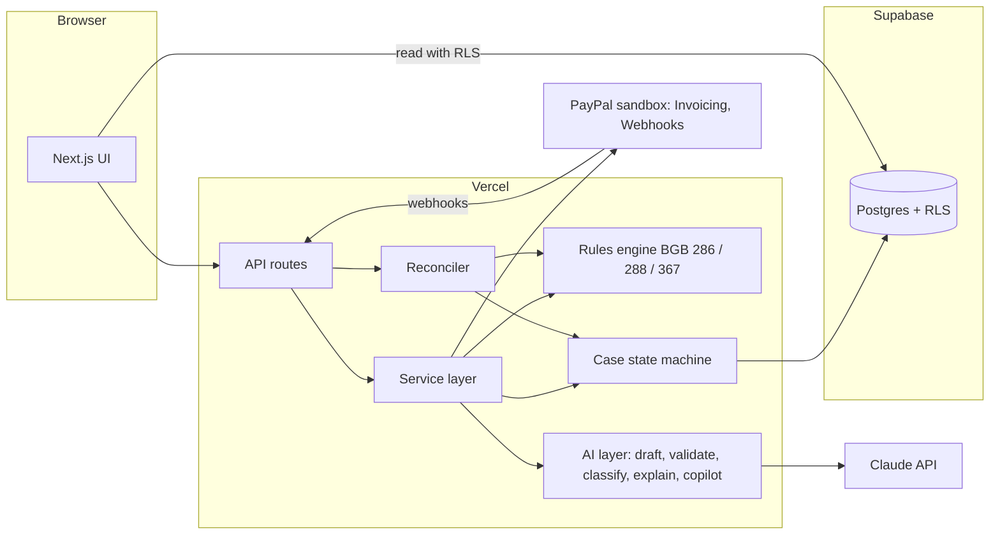

# Mahnwerk

Mahnwerk is a dunning tool for German freelancers and small firms, built on the PayPal Invoicing sandbox. It works out what a late invoice is owed under BGB 286, 288 and 367, drafts the next letter, and waits for you to approve it.

Three parts do the work:

- A rules engine in plain code decides everything that involves money or law: when default starts, how much interest accrues, whether the 40 EUR flat fee applies, how a payment or refund changes the claim.
- Claude drafts the letter wording, classifies a debtor's reply, explains why a step is proposed, and answers questions about the workspace. It never sets an amount or a date and never sends anything.
- You approve every outbound step with a click on "Approve and execute".

Live demo: https://mahnwerk.vercel.app

This is a hackathon demo. It is not legal advice and not a substitute for a lawyer. It runs on the PayPal sandbox only: no real money moves, no real email is sent, and all debtors and invoices are fictional.

## Try it as a judge

No sign-up. Open https://mahnwerk.vercel.app and choose one of two paths.

1. **See the example workspace** (read-only). Seven invoices in different stages at a fixed virtual date of 20 Nov 2026: reminded, first Mahnung, paused by a dispute, paid with interest still owed, and more. Browse cases, claim calculations, letters, the approval queue and the guardrail inspector. Everything that changes data is disabled here.
2. **Try the live demo.** Creates your own private workspace (anonymous session, expires after 48 hours). Suggested walkthrough:
   1. Click "New invoice", pick a debtor, 1000 EUR, due in 1 day. This creates and sends a real invoice on the PayPal sandbox.
   2. Advance the demo clock by 14 days. The rules engine proposes a payment reminder in the approval queue, with AI-written wording.
   3. Open the queue, read the letter, use "Why now" and the "Guardrail inspector", then "Approve and execute". The reminder goes out as a real PayPal sandbox reminder.
   4. Advance the clock further to get the 1st Mahnung, 2nd Mahnung and the handover notice. Amounts and interest come from the rules engine and are validated against the letter.
   5. On a case page, use the customer simulator to pay in full, pay partially, refund, or open a dispute. These run against the PayPal sandbox and flow through the same reconciler as real webhooks.
   6. Paste a debtor reply into "Debtor replied" (or use the prompt-injection example). The reply is classified into a fixed category and nothing is executed.
   7. Ask the copilot "Which cases need action today?".

## How it uses PayPal

All of this runs against the PayPal sandbox with REST calls from the server (no SDK):

- **Invoicing v2**: create, send, remind, record payment, refund and cancel invoices. The PayPal invoice is the source of truth for what was paid.
- **Webhooks**: `INVOICING.INVOICE.PAID`, `REFUNDED`, `CANCELLED`, `UPDATED`, `PAYMENT.CAPTURE.REFUNDED` and the customer dispute events. Signatures are verified with PayPal's verification endpoint. Events are stored first (idempotent on the event id), answered with 200, then processed. Every event triggers a re-fetch of the invoice and a reconcile, so a late, duplicated or reordered webhook cannot corrupt the ledger.
- **Pay link in every letter**: letters point to the PayPal invoice page so the debtor can pay in one click.
- **Disputes**: dispute events pause dunning. The sandbox cannot create real disputes from the API, so the "Open a dispute" button in the simulator is simulated and labelled as such.
- **Limits are handled**: PayPal allows two invoice reminders per day per caller. When the quota is used up, the step falls back to an in-app letter instead of failing.

## How it uses AI

Claude Sonnet is called through the Anthropic API with tool-use schemas, so every answer is structured data rather than free text.

| Feature | What the model does | What code does |
| --- | --- | --- |
| Letter draft | Writes subject, greeting, paragraphs and closing with placeholders such as `{{TOTAL}}` | Fills every amount, date and link from the rules engine, validates the result, falls back to a template if validation fails |
| Reply classification | Puts a debtor reply into a fixed category and suggests a next step label | Treats the reply as untrusted data, flags prompt injection, executes nothing, stores a hash and length instead of the text |
| Explain ("Why now") | Rewrites the engine's reasons in plain language | Supplies the facts and citations |
| Copilot | Answers questions with read-only tools and may propose steps | Proposals go through the same rules and still need approval; the example workspace refuses proposals |

Guardrails you can inspect in the app:

- The model never sees real names, amounts or links, only placeholders.
- A validator checks that the letter contains the required amounts and legal citations and nothing invented. A failed draft is replaced by a deterministic template, so a step never blocks on the model.
- Approval is bound to the exact wording on screen. If a new draft arrives while you are reading, the approve call is refused and you read the new text first.
- Budgets: 40 AI calls per workspace and a global daily cap.

## Architecture



- `lib/rules`: pure functions, no I/O. Decimal arithmetic, 365-day year, interest only on the open principal, allocation of payments to fee, interest, principal (BGB 367), refunds reduce the claim. Property-based tests check the invariants.
- `lib/cases`: state machine with optimistic versioning and an audit row for every transition, plus the reconciler that turns PayPal facts into ledger rows.
- `lib/services`: the use cases (workspaces, invoices, proposals, approval, execution, simulator, demo clock). Execution is leased and idempotent, so a double click or a retry sends once.
- `lib/ai` and `lib/ai-wiring`: model client, prompts, validators, budget, and the glue to the service layer.
- `lib/paypal`: small REST client with schema checks on every response.
- `supabase/migrations`: schema, row level security, and the `mw_transition_case` function.

Case states: open, overdue, reminded, mahnung1, mahnung2, handover_ready, paused_dispute, closed_paid, closed_refunded, closed_cancelled. A paid case with interest still owed closes as paid and proposes a fee invoice for approval.

## Legal basis and limits

Mahnwerk models German default rules for a Kleinunternehmer (no VAT, § 19 UStG). It is an engineering demo, not legal advice. Choices a lawyer might see differently:

- Default interest is the Basiszinssatz (1.52 percent from 1 July 2026) plus 5 points for consumers and 9 points otherwise (§ 288 (1), (2) BGB).
- The 40 EUR flat fee applies only when the debtor is not a consumer (§ 288 (5) BGB).
- Default starts at the latest 30 days after due date (§ 286 (3) BGB, simplified: the date of invoice receipt is assumed to equal the due date). For consumers this needs a warning in the invoice, which the demo does not model.
- A Mahnung is treated as received on the day it is sent. In reality it takes effect on receipt.
- Waiting days between steps are product policy, not law.
- How a payment is allocated across fee, interest and principal (§ 367 BGB) is a modelling choice.
- Refunds reduce the claim and never reopen it. A refund after the claim was settled is flagged for review.

## Run it yourself

Requirements: Node 22 or newer, a Supabase project, a PayPal sandbox app, an Anthropic API key.

```bash
git clone https://github.com/cornex5/mahnwerk.git
cd mahnwerk
npm install
cp .env.example .env.local   # fill in the values, never commit them
# apply supabase/migrations/*.sql in order to your Supabase project
npm run dev
```

Environment variables (see `.env.example`): `PAYPAL_ENV` (sandbox), `PAYPAL_CLIENT_ID`, `PAYPAL_CLIENT_SECRET`, `PAYPAL_WEBHOOK_ID`, `NEXT_PUBLIC_SUPABASE_URL`, `NEXT_PUBLIC_SUPABASE_ANON_KEY`, `SUPABASE_SERVICE_ROLE_KEY`, `ANTHROPIC_API_KEY`, optional `AI_MODEL`. Live PayPal credentials are refused unless `ALLOW_LIVE` is set on purpose. Register `https://<your-host>/api/webhooks/paypal` in the PayPal app for the events listed above.

Seed the read-only example workspace with `npx tsx scripts/seed-golden-sql.ts > golden.sql` and run the SQL in your Supabase project.

Checks:

```bash
npm test          # all tests run offline with fakes for PayPal, Supabase and the model
npm run typecheck
npm run lint
```

## Built with

Next.js 16 (App Router), TypeScript, Tailwind CSS, Supabase (Postgres, row level security, anonymous auth), Vercel, decimal.js, zod, vitest.

AI tools used: the product runs on the Claude API (Claude Sonnet) for drafting, classification, explanation and the copilot. The code was written with Claude Code, with every design decision, scope call and submission step made and reviewed by the author.

## License

MIT, see `LICENSE`.
